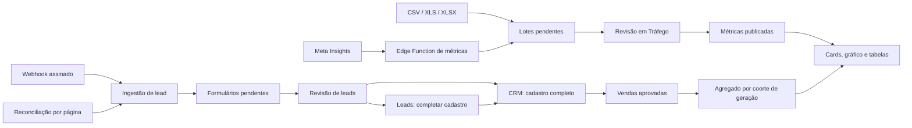

# Auditoria de Tráfego — 11/10/2026

## Resultado e estado deste trabalho

A arquitetura existente tem os elementos adequados para aquisição Meta com revisão humana e integração ao CRM. Entretanto, foram encontrados erros de cálculo, lacunas na captura e recuperação de leads, inconsistências de filtros, problemas de validação e divergências entre os sinais previstos no checkout e os instalados no banco. Corrigir somente a aparência da tela não resolve esses problemas.

Esta entrega contém diagnóstico, reproduções e uma proposta para revisão. O código de produto, os dados comerciais, as aprovações e a configuração publicada não foram alterados. As consultas remotas usaram transações `BEGIN READ ONLY` e `ROLLBACK`. Os diagnósticos locais usam dados sintéticos e ficam em `.verification.local`, ignorado pelo Git.

## Intenção identificada nos arquivos

O propósito é acompanhar o investimento de aquisição, conferir quais leads realmente chegaram, encaminhar os aprovados à operação comercial e relacionar esse investimento às vendas aprovadas ainda válidas. O gestor precisa decidir onde investir com dados coerentes; o SDR precisa receber contatos e respostas preservados; a gestão precisa auditar recebimentos, correções e decisões.

Fontes principais, em ordem de evolução:

- `PLANO_TRAFEGO_META_E_SUGESTOES_2026-09-24.md`: aquisição exclusivamente Meta, fórmulas ponderadas, dimensões estáveis, privacidade, CRM e colaboração privada.
- `TRAFEGO_METRICAS_ESSENCIAIS_SYNC_2026-09-27.md`: indicadores por objetivo e separação entre resultados declarados pela Meta e vendas confirmadas no CRM.
- `TRAFEGO_IMPORTACAO_PENDENTE_E_CRM_2026-09-29.md`: importação sem descartar respostas livres e encaminhamento de cadastros incompletos para complemento.
- `META_IMPORTACAO_MANUAL_2026-10-09.md` e `META_APROVACAO_IMPLANTACAO_2026-10-09.md`: todo novo recebimento exige aprovação explícita em Tráfego, inclusive capturas automáticas e arquivos enviados pela gestão.
- `META_EDICOES_AUDITADAS_2026-10-09.md`: correções com motivo, antes/depois, conflitos detectados e preservação da primeira origem.

As regras mais recentes de aprovação prevalecem sobre as referências antigas a publicação ou encaminhamento automático. A proposta preserva esse controle. A aprovação de uma mudança no software não aprova os lotes comerciais pendentes.

## Arquitetura encontrada

React Query mantém as consultas; `DataSync` observa revisões anônimas em `dashboard_events`, reconcilia periodicamente e atualiza outras abas. RPCs concentram aprovações e edições; RLS protege a leitura. O plano de correção aproveita essas fronteiras.

## Estado publicado verificado

Consulta de 11/10/2026 às **02h25 de Brasília**:

| Item | Evidência do banco |
| --- | --- |
| Conta de anúncios | Uma conta ativa; cadastro BRL e `America/Sao_Paulo`; ID armazenado sem `act_`. |
| Captura de métricas | Última execução consultada com `success`, 14 linhas, às 02h00. |
| Métricas publicadas | 11 linhas por nível: campanha, conjunto e anúncio, de 07/10 a 09/10. Cada nível contém R$ 237,13 e 578 leads declarados. Os níveis não devem ser somados entre si. |
| Aprovações | Três lotes API pendentes, totalizando 54 linhas entre os níveis. |
| Leads individuais | Nenhum formulário e nenhum lote de leads no momento da consulta. |
| Reconciliação de leads | Falha às 02h15: `(#200) Requires pages_manage_ads permission to manage the object`; zero leads persistidos. |
| Agendamento | Os três jobs Meta estão ativos: métricas frequentes, métricas profundas e reconciliação horária. |
| Sinal de métricas | `meta_traffic_daily` tem o trigger de auditoria, mas não o trigger `meta_traffic_signal` previsto no checkout. |

Portanto, números de leads no relatório agregado não comprovam recebimento individual ou entrada no CRM. A permissão externa da Meta continua sendo uma dependência real. Alterar o front ou executar novamente o cron não concede essa permissão.

O histórico remoto registra apenas parte das versões locais consultadas, embora várias funções dessas versões existam. Não se deve interpretar uma versão ausente no histórico como ausência automática do objeto, nem usar `db push` sobre todo o histórico. A documentação recente já determina aplicação seletiva e transacional.

## Falhas prioritárias e causas

### 1. Soma de ações potencialmente sobrepostas — alta

`supabase/functions/_shared/meta-graph.ts:64` soma todos os tipos escolhidos. O sincronizador usa simultaneamente `lead`, `onsite_conversion.lead_grouped` e `offsite_conversion.fb_pixel_lead`; compras seguem o mesmo padrão com `purchase`, `omni_purchase` e o evento do pixel.

A reprodução executou o handler real com três rótulos de leads de valor 10 e importou **30 em cada nível**. Esses rótulos não foram demonstrados como conjuntos disjuntos. CPL, CPA e ROAS ficam incorretos quando os agregados contêm eventos também presentes nos subtipos.

Correção proposta: definir uma ação canônica ou seleção explícita por conta, com fallback documentado que não some agregados com componentes. Guardar a ação selecionada e os valores brutos para rastreabilidade. Comparar uma captura da conta real com o Ads Manager na mesma janela antes de corrigir números históricos. A reprodução não determina o fator de erro dos 578 leads publicados.

Referências: `meta-graph.ts:73` e `meta-insights-sync/index.ts:29`.

### 2. Webhook reconhece recebimentos que não foram persistidos — alta

`meta-lead-webhook/index.ts:47` responde 200 quando falta o token, antes de registrar o evento. Também ignora o retorno de falha de `ingestLeadgenId`, inclusive uma falha no RPC de recebimento. O emissor recebe confirmação mesmo quando não existe um registro durável para recuperar.

Correção proposta: validar assinatura e página, persistir o evento e somente então confirmar o recebimento. Falha de persistência deve gerar resposta recuperável. A leitura da Meta, a extração e a aprovação devem ocorrer em processamento limitado, preservando o evento recebido.

Referências: `_shared/meta-lead-ingest.ts:66` e `meta-lead-webhook/index.ts:55`.

### 3. Recuperação limitada e paginação silenciosamente incompleta — alta

`meta-leads-reconciliation/index.ts:24` pesquisa apenas as últimas 48 horas. Não existe consumidor da fila de eventos `pending/error`. Uma falha longa pode retirar leads da janela antes da recuperação.

`meta-graph.ts:47` encerra a paginação ao atingir 20 páginas mesmo quando existe `paging.next`. A reprodução retornou três páginas com um limite sintético de três, sem erro, embora houvesse continuação. Em produção, a mesma lógica pode encerrar métricas em 10 mil linhas e leads em 2 mil por formulário, apresentando captura incompleta como sucesso.

Correção proposta: consumir eventos pendentes e com falha, manter checkpoint de varredura e continuar por cursor. Quando um limite de execução impedir terminar, registrar cobertura incompleta e retomada; não publicar uma janela parcial como completa. Aplicar timeout e tentativas limitadas às chamadas externas e evitar buscar novamente IDs já processados.

### 4. Filtros e erros produzem leituras inconsistentes — alta

Em `src/pages/Trafego.tsx:478`, `byCampaign` usa `originRows`, enquanto os cards usam `rows` após o filtro de campanha. Selecionar A mostra R$ 100 no card, mas deixa B de R$ 200 na tabela e na exportação. A reconciliação acompanha a mesma lista mais ampla. Nos níveis conjunto/anúncio, a tabela continua agrupando tudo por campanha, impedindo identificar qual conjunto ou anúncio deve ser otimizado.

As falhas de atribuição e reconciliação não são apresentadas. A reprodução de `attributionQuery.isError=true` exibiu **ROAS real 0,00x**, sem aviso, como se a receita estivesse comprovadamente zerada.

Correção proposta: um único recorte alimenta cards, tabela, série, referências e exportação. Agrupar pela dimensão escolhida e usar identificadores de conta e entidade. Separar carregamento, zero confirmado, erro e atribuição insuficiente. O filtro de origem exige tratamento explícito no agregado CRM, que atualmente não recebe esse filtro.

Referências: `Trafego.tsx:467`, `:478`, `:484`, `:526` e `:530`.

### 5. Publicação e edição não emitem todos os sinais esperados — alta

A inspeção de `pg_trigger` em produção encontrou somente `meta_audit_metric_change` em `meta_traffic_daily`. O sinal previsto em `20260925020000_meta_traffic_suggestions.sql:164` está ausente. O trigger de lotes de métricas sinaliza somente INSERT, conforme `20260929100000_meta_traffic_import_pending.sql:19`; aprovação e edição atualizam o lote.

O navegador que escreve invalida suas consultas, mas outra sessão depende de sinais de outras operações ou da reconciliação periódica. Auditoria transacional não substitui o sinal de atualização.

Correção proposta: migration seletiva que restaure sinais de INSERT/UPDATE/DELETE necessários e teste o efeito sobre a revisão correspondente. Verificar publicação → outra sessão → atribuição/CRM; não validar somente o toast local.

### 6. Edição de identidade pode eliminar outra linha pendente — alta

`20261009180000_meta_traffic_audited_edits.sql:157` permite alterar datas e IDs sem detectar colisão com outra linha do lote. A recaptura em `:289` agrupa pela identidade editada e dá prioridade à correção manual.

Uma reprodução SQL, exclusivamente com JSON sintético, mostrou que editar A para a chave B deixa **uma única linha** após o merge; B desaparece. A proteção da correção manual acaba removendo outro fato.

Correção proposta: identidade original imutável para reconciliação e rejeição de chaves duplicadas dentro do lote. Mudanças que atinjam uma identidade publicada precisam de substituição explícita ou conflito. Reimportar uma mesma chave com aprovação continua sendo um comportamento desejado.

### 7. Recapturas mantêm resultados antigos ausentes na janela nova — média/alta

O merge em `20261009180000_meta_traffic_audited_edits.sql:288` conserva toda linha anterior que não tenha a mesma chave no payload novo, inclusive dentro da janela consultada. Quando a captura não traz nenhuma linha, `meta-insights-sync/index.ts:78` não chama o RPC de merge. Uma janela vazia bem-sucedida mantém o lote anterior sem revisão de cobertura.

Correção proposta: informar janela e completude; substituir dados não editados dentro de uma janela integralmente capturada, inclusive quando vazia. Preservar datas fora da janela e correções humanas por identidade original. Fazer isso somente depois de corrigir a paginação para não apagar dados por uma captura incompleta.

### 8. Identidade da conta, metadados e validação insuficientes — alta/média

- A UI pede `act_...`; o banco aceita esse texto; a Edge Function acrescenta `act_` novamente. O handler real produziu `/act_act_123/insights` na reprodução. Normalizar a identidade em front, RPC, CSV e API evita também duplicar a mesma conta entre fontes. A conta publicada atual já usa o formato numérico.
- O sincronizador fixa moeda BRL, deixa o nome da conta vazio e não verifica moeda/fuso na Meta. O cadastro local não comprova os metadados reais. A correção deve consultar os metadados e bloquear moeda incompatível com o escopo BRL atual, sem conversão fictícia. Esses campos existem no [SDK oficial da Meta](https://github.com/facebook/facebook-python-business-sdk/blob/main/facebook_business/adobjects/adaccount.py).
- `meta_validate_traffic_row` não valida os números, o nome, todas as relações entre nível/IDs ou chaves duplicadas. A função instalada aceitou gasto -1, leads -2 e nível NULL nas reproduções de leitura. O lote pode ser recebido e só falhar integralmente na aprovação.
- Conectar/desconectar usa `is_executive`, cuja definição instalada verifica cargo e suspensão, mas não aprovação do cadastro. É preciso combinar o privilégio de gestão com a mesma autorização ativa usada por `traffic_has_access`.

Referências: `Trafego.tsx:400`, `meta-insights-sync/index.ts:67`, `20260927140000_meta_ad_accounts_and_sync_runs.sql:50` e `20260929100000_meta_traffic_import_pending.sql:23`.

### 9. Custos de sincronização e qualidade da extração — média

As consultas de lotes carregam todo o histórico com `select('*')`, incluindo arrays de até 2.000 linhas, a cada 30 segundos e mesmo com outra aba interna selecionada. A tela repete filtros por dia/campanha para agregar dados e o sincronizador consulta os mesmos objetivos novamente em cada um dos três níveis.

Correção proposta: paginar metadados dos lotes, carregar linhas quando o lote for aberto, habilitar consultas conforme a aba e agrupar métricas em uma passagem. Reutilizar objetivos durante uma execução e evitar retransmitir toda a história de importação para atualizações pequenas.

Na extração automática, respostas conhecidas ficam vazias quando a IA retorna baixa confiança ou nenhuma escolha; o fallback por rótulo roda apenas se a chamada lançar erro. Priorizar mapeamento determinístico por campo e usar IA para o que permanecer ambíguo preserva dados reconhecíveis e reduz chamadas. Nenhuma falha de IA deve impedir a persistência das respostas originais.

Referências: `Trafego.tsx:464`, `:465`, `:477`, `meta-insights-sync/index.ts:41` e `_shared/meta-lead-extract.ts:59`.

### 10. Lacunas de operação e documentação — média/baixa

- O desempenho não mostra de forma suficiente a diferença entre última captura, dados publicados e aprovação pendente. A defasagem atual pode parecer falha de API, embora os lotes estejam esperando decisão.
- O plano inicial inclui comparação de período, filtros na URL, funil/qualificação, metas e mensagens não lidas. Esses recursos não estão todos implementados; são lacunas de produto, não evidência de que uma soma atual esteja errada.
- A auditoria de métrica `manual_legacy` é rotulada como CSV pelo trigger atual. Não há esse tipo de linha no recorte publicado consultado, mas a origem fica incorreta quando o caso ocorrer.
- O upload de métricas não tem a proteção por versão de leitura já usada no upload de leads; arquivos abertos rapidamente podem terminar fora de ordem.

## Proposta para revisão de arquitetura

### Alternativas

| Abordagem | Resultado e custo |
| --- | --- |
| **Corrigir as fronteiras existentes, com fila durável e consultas coerentes — recomendada** | Ataca as causas, preserva dados, aprovações, RPCs e layout; exige ajustes de banco, Edge Functions, consultas e testes. |
| Corrigir apenas a tela e as fórmulas | Reduz o primeiro esforço, mas mantém perda/recuperação limitada de leads e inconsistências de recaptura. |
| Reconstruir integralmente o módulo | Permite um modelo novo, mas aumenta migração, risco e esforço sem evidência de que todo o sistema existente precise ser substituído. |

### Desenho recomendado

1. **Captura:** normalizar contas, confirmar metadados e definição de métricas; preservar ações brutas e cobertura da janela. Webhook persiste antes de responder. Reconciliação e tentativas pendentes compartilham processamento limitado, com cursor e estado de execução.
2. **Revisão e publicação:** todas as fontes continuam pendentes. Validar no servidor, preservar identidades originais, detectar colisões e conciliar somente capturas completas. Aprovação e edição atualizam fatos e auditoria na mesma transação.
3. **Leitura:** consultas e funções de agregação alimentam um recorte único para cards, gráfico, tabela e exportação. Campanha, conjunto e anúncio permanecem identificáveis. Os resultados da Meta e os do CRM continuam separados, com coorte e cobertura visíveis.
4. **Sincronização e operação:** restaurar sinais instalados, reduzir consultas pesadas, mostrar dados publicados versus pendentes, último sucesso e falha acionável. A falta de `pages_manage_ads` permanece visível até a autorização externa ser regularizada.

O usuário aprovou prosseguir com o desenho recomendado em 11/10. Os detalhes de esquema, compatibilidade e interfaces foram formalizados em [Tráfego: confiabilidade da captura, aprovação e leitura](superpowers/specs/2026-10-11-traffic-reliability-design.md). A especificação aguarda revisão; o plano e a implementação ainda não foram iniciados.

## Verificação feita nesta auditoria

- 22 testes Node existentes passaram: integração Meta, importação de leads e edições.
- 4 testes Deno do extrator passaram.
- Os scripts independentes de verificação de CSV de métricas e planilhas de leads passaram.
- TypeScript do app e ESLint dos arquivos de Tráfego e funções compartilhadas retornaram sem erros.
- O build de produção passou; Vite concluiu em 36,87 segundos. Log local em `.verification.local/traffic-audit-build.log`.
- Reproduções executaram o componente principal e o handler reais com fronteiras simuladas: filtros divergentes, erro CRM apresentado como zero, prefixo duplicado, ações somadas e paginação incompleta.
- Consultas reais de schema, políticas, permissões, triggers, contagens, execuções e cron usaram somente leitura. Não foram retornados contatos de leads.
- SQL sintético confirmou a colisão no merge e a aceitação de números negativos/nível nulo pelo validador instalado.

Esses testes estabelecem a base e as falhas. Não comprovam uma correção, pois não houve implementação. A navegação autenticada e a comparação das ações com o Ads Manager da conta real ainda precisam fazer parte da validação da implementação.

Diagnósticos: `.verification.local/traffic-audit-probe.mjs`, `traffic-audit-runtime.json`, `traffic-audit-schema.json` e `traffic-audit-db-repros.json`. O relatório não contém credenciais.

## Critérios de aceite propostos para as correções

1. Um evento confirmado pelo webhook sempre existe na fila durável; falhas de captura podem ser retomadas após a janela recente.
2. Uma captura incompleta não se apresenta como completa e não substitui uma janela publicada.
3. Repetir arquivo, webhook ou captura não duplica lead, venda ou métrica; alterações concorrentes e colisões exigem resolução explícita.
4. Filtros produzem os mesmos totais nos cards, tabela e CSV, em cada nível. Erro não se converte em zero.
5. Leads e vendas da Meta não somam agregados e subtipos sobrepostos. A comparação real usa a mesma definição e atribuição.
6. Aprovação manual continua obrigatória; respostas livres, motivos, primeira origem e vínculos CRM são preservados.
7. Outra sessão autorizada recebe a atualização de publicação, edição e decisão; cargos sem acesso continuam bloqueados por RLS e RPC.
8. Histórico de lotes não é retransmitido integralmente em cada polling. O painel informa qual parte foi capturada, publicada ou está pendente.
9. A captura real de leads passa após a autorização da Meta; enquanto ela faltar, o painel mostra a falha e mantém a importação manual disponível.

## Próximo ponto de decisão

Revisar a [especificação escrita](superpowers/specs/2026-10-11-traffic-reliability-design.md). O skill `brainstorming`, exigido pelas instruções da tarefa, determina revisão da especificação e do plano antes de implementar. Este relatório continua registrando a auditoria e suas evidências, não uma implementação concluída.
