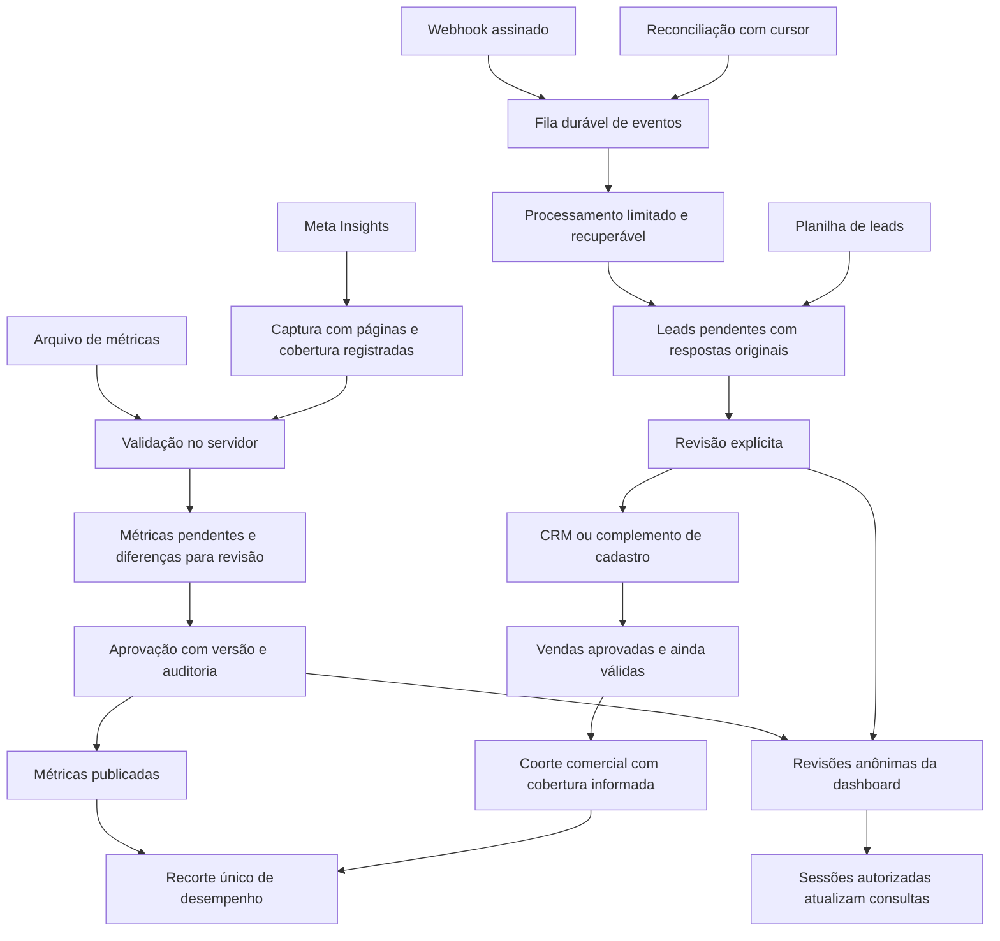

# Tráfego: confiabilidade da captura, aprovação e leitura

Data: 11/10/2026. Estado: especificação aprovada pelo pedido “continua de onde parou”, após sua apresentação para revisão. O [plano de implementação](../plans/2026-10-11-traffic-reliability.md) foi escrito e aguarda revisão e escolha do método de execução. Código de produto e configuração publicada ainda não foram alterados nesta tarefa.

## Intenção e resultado esperado

Tráfego deve permitir acompanhar o investimento na Meta, conferir os contatos recebidos, aprovar sua entrada na operação comercial e relacionar aquisição às vendas válidas do CRM. O gestor precisa decidir com números coerentes; a equipe comercial precisa receber contatos e respostas preservados; a gestão precisa identificar quem recebeu, corrigiu e aprovou cada dado.

Essa interpretação vem dos planos e documentos de setembro e outubro citados em [Auditoria de Tráfego](../../AUDITORIA_TRAFEGO_2026-10-11.md). Os documentos de 09/10 sobre aprovação e edições prevalecem sobre descrições anteriores de publicação automática. A aprovação deste trabalho no software não aprova importações comerciais.

O sucesso exige captura recuperável, cálculos rastreáveis, publicação exclusivamente após revisão, filtros consistentes e atualizações entre sessões. Reutilizaremos as tabelas, RPCs, Edge Functions, React Query e o mecanismo de revisões da dashboard. A abordagem de corrigir essas fronteiras existentes foi aprovada; uma reconstrução integral aumentaria o risco sem resolver uma necessidade adicional demonstrada.

## Escopo e limites

Inclui métricas Meta e CSV, leads via webhook/reconciliação/planilha, revisão e edições auditadas, relações com o CRM, leitura de desempenho, sincronização e diagnósticos necessários à operação. As alterações de colaboração privada ficam limitadas à preservação das permissões e da atualização dos dados que já existem.

Não inclui redes de anúncios adicionais, conversão cambial, redesenho visual completo, mudanças na regra comercial de venda aprovada ou sincronização de calendário. Comparação de períodos, metas e novos funis do plano inicial poderão ser tratados depois da confiabilidade deste fluxo; não são necessários para corrigir as falhas reproduzidas.

O banco consultado tem divergência entre o histórico de migrations e objetos instalados. A implantação será seletiva, com inspeção do schema real. A permissão `pages_manage_ads` ausente na Meta é uma dependência externa identificada: o software deve comunicar a falha e preservar a recuperação, mas não consegue conceder essa permissão por uma alteração de código.

## Regras que nenhuma etapa pode violar

1. Toda confirmação de recebimento de webhook corresponde a um evento persistido; toda publicação corresponde a uma aprovação explícita.
2. Captura parcial nunca se apresenta como completa nem autoriza remoção de dados ausentes.
3. Identidade original, respostas livres, primeira origem, motivos de edição e vínculos comerciais permanecem rastreáveis.
4. Uma repetição da mesma operação não duplica fatos. Concorrência não pode sobrescrever uma decisão ou uma edição silenciosamente.
5. Cards, gráfico, tabela e CSV usam o mesmo recorte e o mesmo nível. Campanha, conjunto e anúncio são níveis alternativos; seus totais não se somam entre si.
6. Ausência de denominador, erro de consulta e cobertura desconhecida são estados distintos de um resultado real igual a zero.
7. Resultados declarados pela Meta e contatos/vendas confirmados no CRM têm definições próprias e aparecem separados.
8. RLS e validação nas RPCs protegem o banco independentemente da interface ou do papel informado pelo cliente.

## Fluxo e responsabilidades

O adaptador Meta cuida de identificação, paginação, limites de requisição e interpretação de ações. O banco cuida de autorização, deduplicação, versões, publicação e auditoria. A camada de leitura monta um recorte e agrega os fatos; os componentes apenas apresentam os resultados e seus estados. A extração de contato auxilia a revisão e não determina se as respostas originais serão armazenadas.

## Identidade, metadados e métricas

### Conta e período

Uma rotina compartilhada aceita um ID numérico com ou sem um único prefixo `act_`, armazena o valor numérico e aplica o prefixo somente na fronteira da Graph API. Rejeita valor vazio, prefixos repetidos e IDs malformados. Cadastro, captura, CSV e edição usam a mesma regra. A migração não junta duas contas existentes que normalizem para o mesmo ID: identifica a colisão e exige resolução explícita antes de alterar referências.

Nome, moeda e fuso devem vir dos metadados reais da conta e ficar registrados na captura. O escopo financeiro permanece BRL; uma conta ou arquivo de outra moeda recebe erro acionável e não tem valores convertidos ou rotulados como reais. Datas diárias conservam o calendário da conta. A interface informa o fuso; não consolida silenciosamente calendários diferentes como se todos fossem Brasília. O limite de data de uma linha API segue o dia atual no fuso verificado da conta; arquivos sem metadados seguem Brasília, conforme o fluxo atual.

Cada execução registra conta, nível, início/fim inclusivos, parâmetros de consulta, versão da Graph API, definição de ações e cobertura. Descrição de atribuição desconhecida aparece como desconhecida. A implementação confirmará quais parâmetros e campos a versão configurada da Meta efetivamente suporta antes de solicitar ou descrever uma configuração de atribuição.

### Seleção de ações e agregação

Não somar um agregado e seus subtipos para produzir leads ou compras. O padrão de seleção é a primeira ação presente na ordem `lead`, `onsite_conversion.lead_grouped`, `offsite_conversion.fb_pixel_lead`; para compras, `purchase`, `omni_purchase`, `offsite_conversion.fb_pixel_purchase`. Uma ação presente com valor zero continua sendo a escolhida. Esse padrão é um fallback explícito de compatibilidade, sujeito à comparação com o relatório real da conta; não pressupõe equivalência entre os nomes.

Cada linha preserva ações e valores brutos, ação escolhida, versão da regra e disponibilidade de cada métrica. Receitas usam o valor da mesma definição de compra escolhida; se não houver valor compatível, ROAS fica indisponível. Tipos de ações ausentes em uma resposta íntegra podem representar zero segundo o contrato confirmado da API; campo não solicitado ou resposta truncada representa indisponibilidade. Nenhuma definição nova é aplicada retroativamente ao histórico publicado sem recaptura e aprovação.

Objetivos são normalizados de forma estável, incluindo `nao_informado`. Consultas de objetivos/metadados se reutilizam durante a mesma execução. Totais de gasto e contagens aditivas são calculados em uma passagem; CTR, CPC, CPM, CPL, CPA e ROAS derivam dos totais e não de médias de taxas. Alcance não é somado como pessoas únicas. Resultados com definições incompatíveis ficam sinalizados e não produzem uma taxa consolidada enganosa.

## Captura de métricas e reconciliação de janelas

A captura só fica completa quando todas as páginas esperadas terminaram sem erro e o intervalo foi verificado. Atingir limite de páginas, tempo ou linhas gera estado parcial com cursor ou falha explícita, nunca sucesso silencioso. Requisições têm timeout e orçamento total; apenas falhas transitórias recebem tentativas limitadas com espera e respeito a `Retry-After` quando disponível.

Reutilizar `meta_sync_runs` para estado e manifesto da captura. Introduzir armazenamento privado de páginas em staging, ligado à execução, para continuar uma captura sem depender da memória de uma Edge Function. Somente o serviço escreve nesse staging; consultas autenticadas recebem metadados autorizados, não os registros privados. Uma execução fechada congela o conteúdo usado para preparar a revisão.

O manifesto completo contém a janela, o nível e as chaves recebidas, inclusive quando nenhuma linha veio. Na preparação do lote:

- Substituir linhas pendentes não editadas da janela completa pelas linhas atuais; preservar linhas fora da janela.
- Preservar edições manuais por sua chave original. Se a recaptura divergir delas, mostrar o conflito, sem vencer a edição automaticamente.
- Uma linha pendente não editada que desapareceu sai da proposta atual. Se a mesma chave já estava publicada, apresentar remoção pendente explícita, com valor anterior e justificativa de ausência na captura completa.
- Aprovar a revisão aplica inserções, atualizações e remoções aprovadas junto da auditoria, na mesma transação. Rejeitar mantém os fatos publicados. Captura vazia pode gerar uma revisão de remoções; não apaga fatos sozinha.
- Colisão entre uma identidade corrigida e outro fato pendente ou publicado bloqueia a operação para resolução explícita. Uma recaptura normal da mesma chave preserva o upsert esperado.

Uma revisão de janela tem um manifesto imutável e pode apresentar partes de até 2.000 linhas para leitura. Todas as partes pertencem à mesma revisão e sua aprovação é atômica, evitando publicar metade de uma substituição. O staging permite mais de 2.000 linhas por captura; o cliente recebe partes sob demanda. A interface informa o total e exige a versão do manifesto revisado na decisão.

Manter lotes CSV e lotes legados como patches das linhas declaradas: eles não autorizam remoções por ausência. RPCs antigas continuam disponíveis para os clientes existentes, mas não podem afirmar completude ou publicar uma substituição de janela sem manifesto válido. A aprovação de lote legado conserva sua semântica atual de upsert, com a validação reforçada.

## Webhook, fila e recuperação de leads

O handler verifica assinatura sobre o corpo original e persiste cada evento válido antes do ACK. Não exige token Graph para gravar o recebimento. Se qualquer evento da mensagem não puder ser gravado, responde com erro recuperável; eventos já persistidos são deduplicados quando a Meta repetir a mensagem. Eventos de páginas fora da lista autorizada ficam registrados como ignorados, sem buscar dados de contato; uma lista vazia não libera todas as páginas.

Ampliar `meta_webhook_events`, preservando a chave única de lead, com disponibilidade da próxima tentativa, lease, identificador da tentativa e classificação do erro. Estados distinguem pendente, em processamento, processado, erro recuperável e ignorado. O serviço reivindica um conjunto limitado sob lock; apenas o proprietário da tentativa vigente conclui esse processamento. Uma resposta atrasada não rebaixa um evento processado. Lease vencido permite recuperação, sem depender do tempo recente de criação do lead.

Usar a reconciliação existente como worker com duas responsabilidades limitadas: drenar pendências elegíveis e descobrir leads novos com cursor por página/formulário. O cursor avança apenas depois da persistência dos eventos daquela página de resultados. Leads já processados não repetem chamadas de detalhes e extração. Sobreposição entre webhook e descoberta não duplica contatos.

O worker limita o tempo ao orçamento do chamador, reserva tempo para salvar progresso e não aguarda extrações ilimitadas. Falhas transitórias usam tentativas com intervalos progressivos de 1, 5, 15 e 60 minutos, mantendo 60 minutos como teto. Erros de autorização/configuração ficam visíveis, têm cadência reduzida e podem ser retomados após correção; não viram “ignorado” definitivo por uma indisponibilidade externa. A fila é consultada independentemente da janela de descoberta recente. Ajustes de cron/timeout mantêm o worker dentro do limite efetivo de execução da plataforma.

A gravação do lead pendente e a conclusão do evento são transacionais ou protegidas pela mesma identidade idempotente. Reprocessamento nunca reabre decisão aprovada/rejeitada nem sobrescreve contato corrigido, primeira origem ou vínculo CRM. Rotinas de claim/conclusão e descoberta são exclusivas de serviço, com `search_path` definido e grants mínimos.

### Extração e encaminhamento

Mapeamento determinístico de nome, telefone e e-mail conhecidos tem prioridade por campo. A IA atua somente nos campos ainda ambíguos; sua seleção precisa referenciar um índice válido e ter confiança numérica finita dentro do intervalo permitido. Falha, baixa confiança ou seleção inválida não apaga um valor determinístico nem impede guardar `field_data` e respostas livres.

Cadastros incompletos continuam revisáveis e seguem para complemento quando aprovados, conforme o comportamento comercial atual. A validação estrita de métricas não é reaproveitada para descartar leads sem telefone, nome ou e-mail. Decisões de encaminhamento permanecem explícitas e auditadas.

## Validação, edições e autorização no banco

Validar cada linha de métrica como objeto JSON com data real, nível não nulo, IDs normalizados, moeda suportada e forma correta da hierarquia: campanha exige campanha; conjunto exige campanha e conjunto; anúncio exige os três. Validar limites de texto, números finitos não negativos, contagens inteiras e limites compatíveis com a precisão das colunas. Rejeitar chaves repetidas dentro de uma revisão ou arquivo; não escolher uma delas por ordem de chegada.

A edição preserva uma chave original imutável e aplica a chave efetiva somente após validar unicidade e compatibilidade com conta/nível da revisão. Lotes que misturam contas ou níveis seguem a regra documentada do importador manual; uma revisão de captura API pertence a uma conta e um nível. Correções de identidade em fatos publicados movem a chave de forma atômica e auditada, bloqueando colisão; não removem outro fato para liberar espaço.

Versão esperada, lock, validação, atualização do fato, motivo e auditoria pertencem à mesma transação. Manter a comparação nula segura já instalada. Campos ausentes em CSV parcial conservam a semântica atual de atualização dos campos declarados; ausência não se transforma em zero conhecido. Fatos históricos sem informação de disponibilidade ficam identificados como legados.

Conectar/desconectar conta exige privilégio executivo e acesso ativo ao módulo, incluindo cadastro aprovado e perfil não suspenso. Aprovar/editar exige o papel apropriado e acesso ativo, verificado na RPC. Leituras permanecem limitadas por RLS; SDRs e outros papéis comerciais não recebem acesso a métricas privadas por terem acesso a contatos. Corrigir a auditoria de `manual_legacy` para registrar a origem real.

## Recorte de desempenho e atribuição comercial

Extrair funções de seleção e agregação da tela para uma camada de leitura testável. O recorte contém período válido, nível, conta, campanha e origem. Cards, série diária, tabela, exportação e consultas relacionadas recebem esse mesmo recorte. A tabela identifica a dimensão selecionada: campanha; campanha/conjunto; ou campanha/conjunto/anúncio. Ordenação e paginação são determinísticas.

Os estados de consulta são carregando, pronto, erro e cobertura insuficiente. Erro de atribuição/reconciliação mostra mensagem e opção de repetir; não rende zero. Denominador zero produz “—” para taxas, com contexto. O total de uma tabela paginada corresponde ao recorte inteiro, e o CSV exporta o mesmo conjunto, com os filtros e a definição registrados.

No nível campanha, preservar a coorte pela data de geração do lead: vendas aprovadas ainda válidas de leads Meta daquela coorte. CPA real = gasto compatível / quantidade de vendas dessa coorte; ROAS real = receita válida dessa coorte / gasto compatível. Cancelamentos e estornos continuam excluídos pela regra atual. Datas de venda não substituem a data de geração do lead.

O filtro de origem de métrica não atribui uma origem comercial inexistente ao lead. Exibir quantidades comerciais para as campanhas comprovadamente correspondentes, com cobertura informada. Se origem, conta, identidade ou período deixar o gasto parcial em relação à coorte, bloquear CPA/ROAS real e explicar a incompatibilidade; não ratear receita ou vendas. IDs desconhecidos aparecem como não atribuídos. Conjunto e anúncio não recebem uma atribuição CRM inferida sem vínculo demonstrável.

A reconciliação distingue leads declarados, contatos recebidos, pendentes de decisão, aprovados e vinculados ao CRM. Diferenças não são chamadas de perda automaticamente: podem decorrer de definição de ação, atraso, autorização, formulário não recebido ou cobertura parcial. A captura individual e os agregados não têm obrigação de coincidir sem essas condições verificadas.

## Sincronização e custo de consultas

Restaurar e verificar os triggers do banco para publicação/edição/remoção de métricas, alterações de lotes/revisões e decisões de leads. Os sinais continuam anônimos, com tópicos existentes adequados; não carregam contato nem métricas privadas em `dashboard_events`. Uma operação transacional deve produzir sinal após mudanças efetivas, sem depender de uma aba local para avisar outra sessão.

Reutilizar `DataSync`, sua atualização em tempo real, reconciliação periódica e retomada em foco/online. Restringir a esta tarefa o ajuste de consultas de Tráfego; não redesenhar a sincronização global da dashboard.

Listas de importações carregam metadados paginados, sem os arrays de linhas. Abrir uma revisão busca suas partes; sair da aba interrompe polling pesado. O número de pendências pode ter consulta leve independente. Agrupamentos de desempenho usam uma passagem e não repetem o filtro completo por dia e campanha. Uploads protegem o resultado assíncrono por versão do arquivo para impedir que uma leitura antiga substitua a mais recente.

A tela informa última tentativa, último sucesso completo, janela capturada, janela publicada, revisões pendentes e falha acionável. O detalhe de execução diferencia nenhuma linha encontrada de falha ou captura parcial. Mensagens externas são sanitizadas, sem tokens, cabeçalhos de autorização ou respostas contendo contatos.

## Compatibilidade, implantação e recuperação

As alterações de schema são aditivas, com metadados versionados e interfaces novas para staging, manifesto e processamento. Preservar assinaturas antigas por wrappers quando necessário, sem afrouxar autorização. Conteúdo antigo sem manifesto mantém semântica de patch; status histórico não é reinterpretado como aprovação nova. Não executar normalização em massa, recálculo ou publicação de fatos históricos sem revisão.

A sequência arquitetural é: proteção do banco e validação; fila e captura com manifesto; leitura e sinais; verificação integrada; implantação seletiva. O plano posterior detalhará arquivos, contratos exatos das RPCs, tarefas e comandos após aprovação desta especificação.

Antes da implantação, comparar as definições instaladas com as migrations locais e registrar o ponto de partida. Aplicar somente alterações desta tarefa e conferir grants, RLS, triggers e assinaturas resultantes. Publicar banco compatível antes das funções que usam os novos contratos, depois a interface. Atualizar tipos gerados do cliente sem alterar manualmente contratos divergentes.

Em falha, interromper novos workers/capturas e restaurar versões compatíveis das funções e da interface. Preservar fila, staging, manifesto, revisões e auditoria; não apagar a evidência nem reverter automaticamente uma aprovação comercial. Uma publicação incorreta exige correção explícita com trilha de auditoria. A recuperação inclui retomar pendências e conferir que decisões antigas continuam intactas.

## Critérios de verificação e aceite

Os testes existentes estabelecem a base, mas passaram apesar das falhas reproduzidas. A implementação seguirá TDD com regressões que falham antes de cada correção. O conjunto de aceite é:

| Área | Condição verificável |
| --- | --- |
| Contas | `123` e `act_123` usam a mesma identidade; URL nunca contém `act_act_`; colisão legada não junta fatos. |
| Métricas | Três aliases de 10 não produzem 30; zero canônico não ativa fallback; receita e ação de compra são compatíveis; desconhecido não vira zero. |
| Captura | Última página não lida impede completude; reinício retoma staging; janela vazia completa gera diferenças revisáveis; mais de 2.000 linhas não publica uma parte da janela. |
| Revisão | Edição A para chave ocupada B falha sem perder linhas; recaptura conserva edição original; revisão concorrente falha por versão; aprovação e auditoria revertem juntas em erro. |
| Webhook | Sem token Graph, evento continua persistido; falha no recebimento gera resposta recuperável; assinatura inválida não entra na fila. |
| Fila | Repetições e workers concorrentes geram um único lead; tentativa atrasada não rebaixa processado; lease expirado retoma; evento antigo volta após correção externa. |
| Extração | Campo conhecido permanece quando a IA falha ou tem baixa confiança; seletor inválido é rejeitado; original permanece completo. |
| Validação | Nível nulo, números negativos/não finitos, hierarquia inválida e chaves duplicadas são rejeitados no servidor; lead incompleto permanece revisável. |
| Autorização | Cadastro pendente/suspenso não conecta, aprova ou edita; serviço pode operar fila; papéis sem Tráfego não leem fatos privados. |
| Leitura | Selecionar campanha A remove B de cards, tabela e CSV; cada nível identifica suas entidades; erro CRM não mostra ROAS zero; coorte incompatível não calcula taxa. |
| Sincronização | Publicação, edição e decisão atualizam uma segunda sessão autorizada; signals não expõem dados; histórico não transfere arrays inteiros em polling. |
| Operação real | Metadados correspondem à conta; janela e ação são comparadas com Ads Manager; leads são recebidos e recuperados após regularizar a autorização Meta. |

Além das regressões Node/Deno e testes transacionais de banco, executar TypeScript, lint dos arquivos alterados, build e navegação autenticada com duas sessões e papéis relevantes. Usar dados sintéticos para decisões de teste; nunca aprovar lotes reais para validar uma alteração técnica. Comparação com Ads Manager e captura com a permissão corrigida exigem evidência real antes de declarar essas integrações plenamente funcionais.

## Revisão deste documento

Autorrevisão concluída quanto a escopo, consistência, ausência de placeholders e ambiguidades principais: captura vazia, alias com zero, conflitos de chave, contratos legados, remoções revisadas e limites de partes foram explicitados. A especificação foi aprovada. O próximo ponto de decisão é a revisão do plano e a escolha do método de execução previstas no workflow solicitado.
